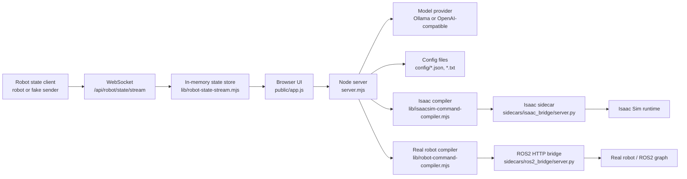

<!-- Archive detail doc. Do not read by default. Current summary lives in docs/ARCHITECTURE.md. -->

# Robo-Doge API Architecture

This document describes the app architecture, runtime modes, local HTTP API, robot telemetry stream, and config surfaces.

## Overview

Robo-Doge is a local command console for a robot dog. The browser UI sends user text or speech-derived text to the Node app server. The server calls the configured LLM, parses command JSON, compiles that command into a runtime-specific envelope, and dispatches it to either Isaac Sim or the real robot bridge.

Real robot mode also accepts continuous robot state messages over WebSocket. The UI polls the latest state snapshot and renders robot info plus a floorplan mini map.



## Runtime Modes

| Mode | Target id | Target kind | Main use | Launch helper |
| --- | --- | --- | --- | --- |
| Isaac Sim | `isaacsim` | `isaacsim` | Sim preview and sidecar dispatch | `scripts/start-robo-doge-isaacsim.bat` |
| Real robot | `ros2_real` | `ros2-bridge` | ROS2 bridge dispatch and robot telemetry mini map | `scripts/start-robo-doge-real.bat` |

Runtime target selection comes from `config/robot-runtime.json` unless overridden by `ROBOT_RUNTIME_TARGET` or launcher args.

## Process Layout

| Process | File | Role |
| --- | --- | --- |
| App launcher | `run.mjs` | Starts managed sidecars, then starts `server.mjs`. Speech sidecar failure is non-fatal. |
| HTTP server | `server.mjs` | Owns API routes, static files, and WebSocket upgrade handling. |
| Browser UI | `public/app.js` | Loads config, sends chat, polls feedback/state, renders command UI and mini map. |
| Speech sidecar | `sidecars/parakeet_onnx_bridge/server.py` | Local HTTP bridge for Parakeet ONNX speech transcription on `127.0.0.1:8893`. |
| Isaac sidecar | `sidecars/isaac_bridge/server.py` | HTTP bridge for Isaac commands and runtime feedback. |
| ROS2 sidecar | `sidecars/ros2_bridge/server.py` | HTTP bridge for real robot commands and feedback. |
| Fake state client | `scripts/fake-robot-state-client.mjs` | WebSocket robot-state sender for mini map testing. |

## HTTP API

All JSON routes return `application/json; charset=utf-8`.

### `GET /api/config`

Returns public app config needed by the browser.

Includes:
- app labels from `config/app.json`
- active model profile and available model profiles
- speech profile config and activation phrases
- robot runtime target config
- command prompt/schema previews
- robot state stream paths

Key response fields:

```json
{
  "app": {},
  "activeProfile": {},
  "availableProfiles": [],
  "speech": {},
  "robotRuntime": {
    "activeTarget": {},
    "availableTargets": [],
    "feedbackPollMs": 2500,
    "statePollMs": 125,
    "stateStreamPath": "/api/robot/state/stream",
    "stateSnapshotPath": "/api/robot/state"
  }
}
```

### `POST /api/chat`

Primary command endpoint.

Request:

```json
{
  "input": "go to the living room"
}
```

Server flow:

1. Builds system prompt from `config/system-prompt.txt`, command schema, command types, and waypoints.
2. Calls active LLM profile.
3. Attempts to parse raw response as JSON.
4. Builds Isaac preview and real-robot preview in parallel.
5. Dispatches only to the active runtime target when dispatch rules allow it.

Response:

```json
{
  "input": "go to the living room",
  "model": "nemotron-3-nano:latest",
  "provider": "ollama",
  "response": "{\"command\":\"move\",\"waypoint\":\"living_room\"}",
  "parsed": {
    "command": "move",
    "waypoint": "living_room"
  },
  "isaacSim": {},
  "isaacDispatch": null,
  "robotRuntime": {},
  "robotDispatch": null,
  "runtimeTarget": {}
}
```

### Settings Routes

| Route | Method | Body | Purpose |
| --- | --- | --- | --- |
| `/api/settings/profile` | `POST` | `{ "profileId": "local_ollama" }` | Updates `config/runtime.json` unless locked by `APP_MODEL_PROFILE`. |
| `/api/settings/speech-profile` | `POST` | `{ "profileId": "local_whisper_base_en" }` | Updates `config/speech-runtime.json` unless locked by `APP_SPEECH_PROFILE`. |
| `/api/settings/robot-target` | `POST` | `{ "targetId": "ros2_real" }` | Updates `config/robot-runtime.json` unless locked by `ROBOT_RUNTIME_TARGET`. |

### Speech Routes

| Route | Method | Purpose |
| --- | --- | --- |
| `/api/speech/health` | `GET` | Probes the configured Parakeet sidecar. A 200 response from the wrong sidecar is treated as an error. |
| `/api/speech/transcribe` | `POST` | Sends buffered WAV audio to Parakeet when the active speech profile provider is `parakeet-sidecar`. |

Default speech sidecar URL:

```text
http://127.0.0.1:8893
```

The real-robot ROS2 bridge stays on `http://127.0.0.1:8892`; keep these ports separate so speech health checks cannot accidentally reuse the robot bridge.

The default Parakeet speech sidecar uses `onnx-asr` with the model alias `nemo-parakeet-tdt-0.6b-v3`, backed by `https://huggingface.co/istupakov/parakeet-tdt-0.6b-v3-onnx`. Install it in the configured Python environment with `pip install "onnx-asr[cpu,hub]"`.

### Isaac Routes

| Route | Method | Purpose |
| --- | --- | --- |
| `/api/isaac/health` | `GET` | Probes configured Isaac sidecar health. |
| `/api/isaac/feedback` | `GET` | Reads Isaac runtime feedback from sidecar. |
| `/api/isaac/dispatch` | `POST` | Builds or accepts an Isaac preview envelope and dispatches it. |

`POST /api/isaac/dispatch` accepts either a ready preview object or the same command inputs used to build one:

```json
{
  "preview": {}
}
```

or:

```json
{
  "input": "go to the kitchen",
  "rawResponse": "{\"command\":\"move\",\"waypoint\":\"kitchen\"}",
  "parsed": {
    "command": "move",
    "waypoint": "kitchen"
  }
}
```

### Real Robot Routes

| Route | Method | Purpose |
| --- | --- | --- |
| `/api/robot/health` | `GET` | Probes configured ROS2 bridge health. |
| `/api/robot/feedback` | `GET` | Reads real robot bridge feedback. |
| `/api/robot/dispatch` | `POST` | Builds or accepts a real robot preview envelope and dispatches it. |
| `/api/robot/state` | `GET` | Returns latest in-memory robot state snapshot for mini map UI. |

`GET /api/robot/state` response:

```json
{
  "status": "ok",
  "activeRobot": {
    "type": "robot.state",
    "uuid": "dogzilla-local-demo",
    "name": "Robo Doge",
    "pose": {
      "x": 0.42,
      "y": 0.18,
      "theta": 0.52
    },
    "task": "MOVING",
    "timestamp": "2026-04-28T15:00:00.000Z",
    "seq": 12,
    "receivedAt": "2026-04-28T15:00:00.010Z",
    "sequenceStatus": "ok"
  },
  "robots": [],
  "stats": {
    "acceptedMessages": 12,
    "rejectedMessages": 0,
    "totalConnections": 1,
    "activeConnections": 1,
    "lastError": null,
    "lastErrorAt": null
  },
  "streamPath": "/api/robot/state/stream",
  "activeTarget": {}
}
```

## Robot State WebSocket API

### Endpoint

```text
ws://<host>:<port>/api/robot/state/stream
```

The stream only accepts connections when the active runtime target kind is `ros2-bridge`. If the app is in Isaac mode, the server rejects the upgrade with `409`.

### Client Message

Robot sends one JSON message per state snapshot:

```json
{
  "type": "robot.state",
  "uuid": "dogzilla-local-demo",
  "name": "Robo Doge",
  "pose": {
    "x": 0.42,
    "y": 0.18,
    "theta": 0.52
  },
  "task": "MOVING",
  "timestamp": "2026-04-28T15:00:00.000Z",
  "seq": 12
}
```

Validation rules:
- `type` must be `robot.state`
- `uuid`, `name`, and `timestamp` must be non-empty strings
- `timestamp` must parse as ISO-style date/time
- `seq` must be a non-negative integer
- `pose` can be `null`
- when not `null`, `pose.x`, `pose.y`, and `pose.theta` must be finite numbers
- allowed task values: `MOVING`, `IDLE`, `SCANNING`, `PATROLING`, `PATROLLING`, `TRICK`, `TALKING`, `THINKING`

### Server Messages

Ready:

```json
{
  "type": "robot.state.ready",
  "path": "/api/robot/state/stream",
  "receivedAt": "2026-04-28T15:00:00.000Z"
}
```

Ack:

```json
{
  "type": "robot.state.ack",
  "uuid": "dogzilla-local-demo",
  "seq": 12,
  "status": "ok",
  "receivedAt": "2026-04-28T15:00:00.010Z",
  "sequenceStatus": "ok"
}
```

Error:

```json
{
  "type": "robot.state.error",
  "status": "error",
  "error": "robot.state seq must be a non-negative integer.",
  "receivedAt": "2026-04-28T15:00:00.010Z"
}
```

Sequence status values:
- `first`: first message seen for that `uuid`
- `ok`: `seq` is previous `seq + 1`
- `gap`: server detected skipped sequence numbers
- `reset-or-out-of-order`: sequence moved backward or repeated

## Static Assets

Normal browser routes are served from `public/`.

Important assets:
- `/` -> `public/index.html`
- `/app.js` -> browser controller
- `/styles.css` -> UI layout/theme
- `/assets/floorplan.png` -> mini map floorplan background
- `/sounds/robot-bark.mp3` -> command cue

Vendor bundles are exposed under:
- `/vendor/transformers/`
- `/vendor/transformers-ort/`
- `/vendor/moonshine/`
- `/vendor/onnxruntime/`
- `/vendor/vad/`

## Config Files

| File | Purpose |
| --- | --- |
| `config/app.json` | UI text and assistant labels. |
| `config/model-profiles.json` | Model provider profiles. |
| `config/runtime.json` | Active model profile selection. |
| `config/system-prompt.txt` | System prompt template. |
| `config/command-response-format.json` | Command JSON contract. |
| `config/command-types.txt` | Command category guidance. |
| `config/valid-waypoints.txt` | Waypoint guidance for prompt. |
| `config/speech-profiles.json` | Browser and sidecar speech profile definitions. |
| `config/speech-runtime.json` | Active speech profile selection. |
| `config/speech-sidecar.json` | Parakeet sidecar transport and launch config. |
| `config/robot-runtime.json` | Active runtime target and shared robot runtime settings. |
| `config/robot-ros2.json` | Real robot bridge transport, launch, topics, services, and actions. |
| `config/robot-motion.json` | Real robot motion profile settings. |
| `config/robot-actions.json` | Real robot action mappings. |
| `config/robot-waypoints.json` | Real robot waypoint mappings. |
| `config/isaacsim-sidecar.json` | Isaac sidecar transport and launch config. |
| `config/isaacsim-command-map.json` | Isaac command mapping rules. |

## Environment Overrides

| Env var | Purpose |
| --- | --- |
| `APP_HOST`, `APP_PORT` | App server bind host and port. |
| `APP_MODEL_PROFILE` | Locks model profile for process. |
| `APP_SPEECH_PROFILE` | Locks speech profile for process. |
| `ROBOT_RUNTIME_TARGET` | Locks active runtime target. |
| `ROBOT_RUNTIME_DRY_RUN` | Overrides shared robot dry-run flag. |
| `ROBOT_ROS2_BASE_URL` | Overrides real robot bridge URL. |
| `ROBOT_ROS2_TRANSPORT_DRY_RUN` | Overrides real robot transport dry-run. |
| `ROBOT_ROS2_MANAGED_BY_APP` | Controls app-managed ROS2 bridge launch. |
| `ROBOT_STATE_WS_URL` | Fake robot WebSocket destination. |
| `ROBOT_STATE_HZ` | Fake robot telemetry send rate. |
| `ROBOT_STATE_MOVE_MS`, `ROBOT_STATE_IDLE_MS` | Fake robot movement and pause durations. |
| `ROBOT_STATE_START_X`, `ROBOT_STATE_START_Y` | Fake robot route start pose. |
| `ROBOT_STATE_END_X`, `ROBOT_STATE_END_Y` | Fake robot route endpoint. |

## Launch Workflows

Isaac mode:

```bat
scripts\start-robo-doge-isaacsim.bat
```

Real robot demo mode:

```bat
scripts\start-robo-doge-real.bat
```

The real robot launcher forces `ROBOT_RUNTIME_TARGET=ros2_real`, defaults command dispatch to dry-run, and starts `scripts/fake-robot-state-client.mjs` in a second terminal so the mini map moves immediately.

Manual fake state stream:

```bash
npm run fake:robot-state
```

## Frontend Data Flow

1. Browser calls `GET /api/config`.
2. Browser starts feedback polling:
   - Isaac target: `/api/isaac/health` and `/api/isaac/feedback`
   - Real target: `/api/robot/health` and `/api/robot/feedback`
3. Browser starts state polling from `/api/robot/state` when real target is active.
4. User submits text, or speech controller fills the input.
5. Browser posts to `/api/chat`.
6. Browser renders:
   - assistant response in output log
   - parsed JSON in output log
   - robot info and map state from telemetry snapshot

## Multi-Robot Readiness

The backend state store is already keyed by `uuid` and returns a `robots` array. The current UI renders `activeRobot`, defined as the most recently received robot state. The robot tabs are currently visual placeholders. Future multi-robot support should bind tabs to the `robots` array and choose active robot by `uuid`.

## Error Behavior

Common statuses:
- HTTP `400`: invalid client input
- HTTP `409`: runtime/profile selection locked or WebSocket rejected for wrong runtime target
- HTTP `502`: sidecar dispatch or transcription proxy failed
- HTTP `500`: unexpected server error

Sidecar failures are meant to degrade where possible:
- managed speech sidecar failure does not prevent app startup
- Isaac/ROS2 sidecar health errors render in runtime feedback
- robot state validation errors increment rejected message stats and send WebSocket error frames
